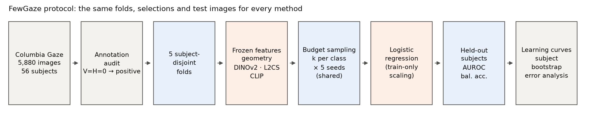
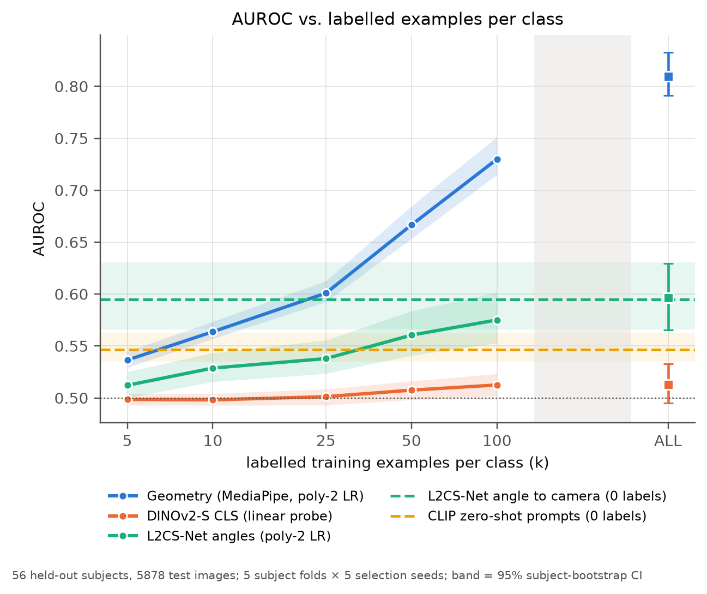
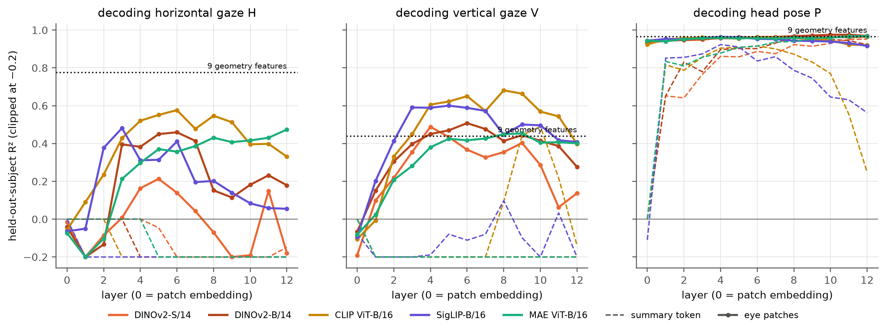

# FewGaze

**How little labelled data does eye-contact detection really need?**

FewGaze is a reproducible study of how classifiers for **camera-directed gaze** improve as the number of
labelled training examples grows, evaluated on **people the model has never seen**. It compares four kinds
of frozen representation: interpretable facial and iris geometry (MediaPipe), generic self-supervised features
(DINOv2), a pretrained gaze estimator (L2CS-Net) and a vision-language model (CLIP). All four use
identical subject-disjoint folds, identical training samples and subject-level confidence intervals. The
analysis plan was committed to git before the first experiment ran.

📄 Paper: [`report/main.pdf`](report/main.pdf) · 🌐 Project page: [`site/`](site/) · 📐 Protocol: [`docs/methodology.md`](docs/methodology.md)



## Research question

> How does the number of labelled examples per class affect held-out-subject performance of different
> computer-vision representations for identifying images in which a person looks toward the camera?

**What is classified.** In the Columbia Gaze Data Set (Smith et al., UIST 2013), each subject's head rests in a
chin rest while a camera at five positions records them looking at targets defined **relative to that camera**.
*Positive* means a gaze offset of (0°, 0°), the paper's "gaze locking"; *negative* covers the other 20 offsets, the
nearest of which is 5° to the side. This is a controlled proxy for eye contact with a camera, **not
interpersonal eye contact**.

## Key findings

Verified results from run `20261023-005930-20d2e4` (clean commit `5f6e0ba`, recorded as `3fbfc55` before a message-only history rewrite, see [`docs/commit_map.md`](docs/commit_map.md); it reproduces the earlier run `20261023-000805-20d2e4` bit-for-bit). Values are mean AUROC over 5 subject folds × 5 seeds,
with 95 % subject-bootstrap CIs. Sources: `results/tables/learning_curves.csv` and `paired_differences.csv`.

1. **Simple geometry was the most label-efficient method at every budget.** Nine MediaPipe eye and head
   features with a degree-2 logistic regression reached AUROC 0.537 [0.529, 0.545] at 5 labels per class,
   0.601 [0.592, 0.613] at 25, 0.730 [0.715, 0.751] at 100 and 0.810 [0.791, 0.833] with all training data.
2. **A linear probe on frozen DINOv2-S stayed at chance** (0.499–0.513) even with about 4,700 training images.
   A post-hoc diagnostic shows that its embeddings decode *head pose* from unseen people (R² = 0.95) but
   not gaze direction (R² < 0). An eye-region crop helped only a little (0.562 at ALL, post-hoc).
3. **The pretrained gaze estimator mainly helped with zero labels.** L2CS-Net's angle-to-camera score
   gave 0.595 [0.566, 0.630] without any FewGaze label, better than every method trained on ≤ 10 labels
   per class. A head trained on its two angles matched but never improved on this (0.596 at ALL). Its
   predictions are biased on this dataset, and per-subject AUROC ranged from 0.32 to 0.94.
4. **The 5° boundary is unsolved.** At k = 25, geometry predicted "camera" for 71.8 % of true positives
   but also for 67.7 % of the 5°-off negatives. Its discrimination comes from the larger offsets.
5. **Head pose matters.** Geometry's AUROC (ALL) fell from 0.891 at a frontal pose to 0.718–0.766 at ±30°.
6. **Label noise** reduced geometry's AUROC roughly in proportion to the flip rate (k = 100: 0.730 →
   0.695 / 0.656 / 0.602 at 10 / 20 / 30 % flips). CLIP zero-shot was weak (0.547).



### Study 2 (pre-registered): where does gaze live inside foundation models?

Ridge probes on every layer of DINOv2-S/B, CLIP ViT-B/16, SigLIP-B/16 and MAE ViT-B/16 (frozen). Two token
types were probed: the summary token and the mean of the patch tokens over each eye. Scores are on held-out people,
using the same five folds. Sources: `results/study2/`.

7. **The summary token holds head pose, not gaze.** Its horizontal-gaze R² never rose above 0.00 at any layer of any
   model. Final-layer head-pose R² was 0.92–0.97 for DINOv2 and MAE.
8. **Eye-patch tokens do carry gaze, mostly in the middle layers.** The best layer reached R²(H) 0.21–0.58 and
   R²(V) 0.45–0.68. Every model exceeds the geometry features on vertical gaze (0.44); none reaches them on
   horizontal gaze (0.78). Most of this is lost by the last layer (CLIP 0.58 → 0.33, SigLIP 0.48 → 0.05). MAE, the
   pixel-reconstruction model, is the exception and peaks at the last layer. Choosing the ridge α with person-grouped
   CV (sensitivity analysis S2-b) raises all eye-token R² values (best R²(H) 0.51–0.64) and leaves the conclusions
   unchanged.
9. **Eye contact read out from decoded gaze.** At the best layer, chosen with hindsight, AUROC was 0.71–0.83 (CLIP
   layer 8: 0.834; geometry: 0.813). Post-hoc analysis P3 picks the layer on training people only. With it, CLIP reached 0.827 against geometry's 0.816 under the same procedure (paired difference +0.011, fold SD 0.019, not distinguishable). The other four models trailed by 0.04–0.09. This readout is trained on continuous gaze angles, and its eye boxes come from MediaPipe, so it shows that the information is present; it is not a label-free alternative.



## Live demo

Live at **https://fewgaze.pages.dev**: camera and photo upload, with the paper at `/paper.pdf`.

The project page ([`site/`](site/)) includes an in-browser demo of the best method. A visitor picks a face photo,
and MediaPipe plus the exported geometry classifier return P(looking at the camera), the measured eye
landmarks and warnings when the photo is outside the training conditions. The photo never leaves the browser.
The browser pipeline matches the Python pipeline to within 4 × 10⁻⁴ in probability, with 0 of 24 decisions
differing ([`site/demo/README.md`](site/demo/README.md)). The model was trained on 56 people in one lab, so it is
a research demo and not an eye-contact detector.

## Methods

| Method | Representation (frozen) | Trained head | Prior supervision |
|---|---|---|---|
| **Geometry** | MediaPipe Face Landmarker → 9 features: iris offset along/across each eye, lid aperture, head rotation | standardise → degree-2 polynomial → logistic regression | landmark model only, no gaze labels |
| **DINOv2-S** | `facebook/dinov2-small`, CLS token of the 224² face crop | linear probe | self-supervised (LVD-142M) |
| **L2CS-Net** | ResNet-50, Gaze360 weights → (pitch, yaw); also a 0-label "angle to camera" score | degree-2 polynomial → logistic regression | **supervised gaze labels (Gaze360)** |
| **CLIP** (exploratory) | ViT-B/32 with two fixed prompts | none (zero-shot) | 400 M image–text pairs |
| Ablations | geometry without the polynomial; DINOv2 mean-patch; L2CS 2048-d features; CLIP linear probe | linear probe | |

The logistic regression is fixed in advance (C = 1, balanced class weights, threshold 0.5) and never tuned. Every
learned transform is fit on the training selection only.

## Protocol in one paragraph

The 56 subjects are dealt into **5 folds by identity** (automated tests check that no person appears in both
train and test). In each fold, for each of 5 seeds, **k ∈ {5, 10, 25, 50, 100, ALL} examples per class** are
drawn from the training subjects. Budgets are nested, and **every method gets the same examples**. Metrics are
AUROC (primary) and balanced accuracy on all held-out images. The 95 % CIs come from a fold-stratified
**subject** cluster bootstrap with 1,000 replicates, using the same resamples for every method so that
differences are paired. Label-noise conditions flip exactly 10 / 20 / 30 % of each class's training labels;
test labels stay clean. Full details, including every deviation and the two post-hoc analyses: [`docs/methodology.md`](docs/methodology.md).

## Dataset and licensing

The Columbia Gaze Data Set is **not included and must not be redistributed**. Its terms are non-commercial
use, with a citation of Smith et al. 2013. See [`data/README.md`](data/README.md) for how to obtain it. The audit
([`results/audit/audit_summary.md`](results/audit/audit_summary.md)) found 5,880 readable images of 56 subjects in a
complete grid, plus **one byte-identical pair with conflicting gaze annotations**, which was excluded. No
dataset images appear in this repository, the paper or the site.

## Installation

Tested with Python 3.11.17 on Windows 11 with an RTX 3050 (CUDA 12.1). Linux and WSL use the same commands. The
core package (splits, training, metrics, statistics, plots, tests) needs only the lightweight dependencies.

```bash
conda create -n fewgaze python=3.11 -y && conda activate fewgaze     # or python -m venv .venv
# GPU (optional; CPU works, only slower for DINOv2/L2CS/CLIP extraction):
pip install torch==2.5.1 torchvision==0.20.1 --index-url https://download.pytorch.org/whl/cu121
pip install -r requirements.txt
pip install -e .            # optional extras: pip install -e ".[geometry,models,dev]"
pytest                      # 42 tests on synthetic data; no dataset or weights needed
```

L2CS-Net weights: the upstream Google Drive folder returned 404 on 2026-10-22. FewGaze uses the same Gaze360
checkpoint re-hosted as safetensors by Py-Feat:

```bash
mkdir -p cache/weights
curl -L -o cache/weights/l2cs_gaze360_resnet50.safetensors \
  https://huggingface.co/py-feat/l2cs/resolve/main/l2cs_gaze360_resnet50.safetensors
```

The MediaPipe, DINOv2 and CLIP models download automatically on first use.

## Reproducing the experiments

```bash
python scripts/audit_dataset.py          --config configs/experiment.yaml   # ~1 min
python scripts/extract_features.py       --config configs/experiment.yaml   # ~20 min (12 min CPU geometry + GPU models)
python scripts/run_experiments.py        --config configs/experiment.yaml   # ~10 min incl. 1,000-replicate bootstrap
python scripts/analyze_errors.py         --config configs/experiment.yaml
python scripts/generate_report_assets.py --config configs/experiment.yaml   # figures, LaTeX tables, site data
python scripts/export_demo_model.py                                          # demo model (site/demo/model.json)
cd report && latexmk -pdf main.tex                                          # paper

# post-hoc analyses (P1, P2; clearly separated in results/posthoc/)
python scripts/extract_features.py --config configs/posthoc_eyes.yaml --stages eyes
python scripts/run_experiments.py  --config configs/posthoc_eyes.yaml --no-noise
python scripts/posthoc_analyses.py

# Study 2 (layer probing; ~2 h extraction on a laptop GPU, ~3 h probes on CPU)
python scripts/study2_extract.py       --config configs/experiment.yaml   # cache/study2/<model>.npz
python scripts/study2_probe.py         --config configs/experiment.yaml   # results/study2/decoding.csv, readout.csv
python scripts/study2_grouped_alpha.py --config configs/experiment.yaml   # sensitivity S2-b
python scripts/study2_nested_layer.py  --config configs/experiment.yaml   # post-hoc P3 (layer chosen on training people)
python scripts/paper_figures.py                                           # paper figures + Study 2 table
python scripts/export_site_data.py                                        # site/data/extras.json
python scripts/build_pages.py --out <dir>                                 # static build for https://fewgaze.pages.dev (no dataset images)
npx wrangler pages deploy <dir> --project-name fewgaze --branch main
```

Every setting lives in [`configs/experiment.yaml`](configs/experiment.yaml). Feature caches are keyed by
model, preprocessing and dataset fingerprint, can resume after an interruption, and are rejected if stale. Each run
writes `results/runs/<run_id>/` with per-run metrics (`results.jsonl`), per-image scores, the exact training-sample
IDs and flip masks, eligibility, and provenance (config, git commit, dataset fingerprint, library versions). The
schema is in [`results/README.md`](results/README.md).

**Exit codes:** 0 ok · 2 dataset missing or unparseable · 3 audit found blocking problems / no results yet ·
4 an extraction stage failed · 5 no features cached.

## Results and figures

| Figure | File | Script |
|---|---|---|
| 1 Pipeline | `results/figures/fig1_pipeline.png` | `generate_report_assets.py` |
| 2 Dataset composition | `fig2_dataset_composition.png` | `audit_dataset.py` |
| 3 / 4 AUROC and balanced-accuracy learning curves | `fig3_*`, `fig4_*` | `generate_report_assets.py` |
| 5 Label noise | `fig5_label_noise.png` | 〃 |
| 6 Head pose | `fig6_head_pose.png` | 〃 |
| 7 Confusion matrices (k = 25) | `fig7_confusion.png` | 〃 |
| 8 Efficiency | `fig8_efficiency.png` | 〃 |
| 9 Error examples | `figures/local_only/` (**never committed**: dataset images) | `analyze_errors.py` |
| S1–S3 Ablations, per-gaze-cell prediction rates, per-subject spread | `figS*` | `generate_report_assets.py` |
| P1–P2 Post-hoc diagnostics | `results/posthoc/figures/` | `posthoc_analyses.py` |
| Paper figures (teaser, iris shift, t-SNE, L2CS bias, forest, per-subject) | `results/figures/fig_*` | `paper_figures.py` |
| Study 2 layer curves, heatmap, readout | `fig_s2_layers`, `fig_s2_heat`, `fig_s2_readout` | `paper_figures.py --only study2` |

Result categories: everything under `results/tables` and `results/figures` is a **verified experimental result**
from the run named in `results/runs/LATEST`. Everything under `results/posthoc/` is **post-hoc exploratory**.
Synthetic numbers appear only in `tests/`.

## Repository structure

```text
configs/        experiment.yaml (primary), posthoc_eyes.yaml (P2)
src/fewgaze/    dataset, labels, splits, geometry, embeddings, gaze_estimator, extraction, features (cache),
                train, evaluate, metrics, statistics (subject bootstrap), summary, errors, plots, utils
scripts/        audit, extract, run, analyze errors, report assets, post-hoc analyses
tests/          42 tests: leakage, labels, sampling, noise isolation, metrics vs sklearn, closed-form bootstrap,
                cache invalidation/resume, result schema, determinism
results/        audit/, runs/, tables/, figures/, posthoc/
report/         main.tex, references.bib (DOI-verified), generated/ tables, figures/
site/           static project page rendered from site/data/results.json
docs/           methodology.md (pre-registered plan + deviations), dataset_card.md, model_card.md
```

## Limitations

* One controlled dataset: 56 people, one lab, 2 m, yaw-only head pose, a chin rest. Camera-directed gaze ≠ eye contact.
* L2CS-Net was trained with gaze labels, so its *k* undercounts its supervision. The comparison is between off-the-shelf systems.
* Heads and hyperparameters were fixed in advance. Non-linear probes on embeddings could change their ranking.
* CIs capture subject-sampling uncertainty with models held fixed. The SD across runs is reported separately.
* No demographic labels are available, so no fairness analysis was done. Not for surveillance or attention monitoring.

## AI use

This project was built with heavy AI assistance. This section says who did what.

* **Origin of the idea.** I drafted the research question and the initial project plan with help from an AI chat
  assistant. The project is best read as a replication and extension of Smith et al. (2013) built around that question.
* **Implementation, analysis and writing.** Nearly all code was written by Claude (Anthropic), working as a coding
  agent in Claude Code under my direction. That covers the pipeline, the tests, the experiment and analysis scripts,
  the figures, the website and demo, and the first drafts of the paper and of this README. Claude also ran the
  experiments and proposed many method details, including the degree-2 polynomial head, the subject-cluster
  bootstrap, the Study 2 design and the S2-b and P3 corrections. It also caught and recorded an error in its own
  Study 2 pre-registration. The qualitative error review in `results/tables/error_review_manual.csv` is Claude's
  visual inspection, not a human annotation.
* **My part.** I chose the topic and the dataset and obtained access to it. I set the goals and the scope at each
  step: the label-budget protocol, the extended paper with a new study, the generative-VLM experiment, the website and
  camera demo, the works to cite and the public release. I reviewed the code, figures and numbers, and edited the
  paper text. I am responsible for every claim in the repository.
* **Timeline.** The commit timestamps are real. The project was built over about two days of AI-assisted sessions,
  from 22 to 24 October 2026.
* **History edit.** Before the first push I rewrote the commit messages once, to remove automatic AI co-author lines.
  File contents were not changed ([`docs/commit_map.md`](docs/commit_map.md)). This section replaces that attribution.

## References

Key sources: Smith et al. 2013 (Columbia Gaze, gaze locking); Müller et al. 2018; Zhang et al. 2017; Oquab et al. 2024
(DINOv2); Abdelrahman et al. 2023 (L2CS-Net); Kellnhofer et al. 2019 (Gaze360); Radford et al. 2021 (CLIP);
Lugaresi et al. 2019 / Kartynnik et al. 2019 / Ablavatski et al. 2020 (MediaPipe). Full, DOI-verified BibTeX is in
[`report/references.bib`](report/references.bib).

## Citation

See [`CITATION.cff`](CITATION.cff). If you use the dataset, cite Smith et al. (UIST 2013).

## Licence

Code: MIT ([`LICENSE`](LICENSE)). It does **not** cover the dataset, derived crops and features, or third-party model weights.
